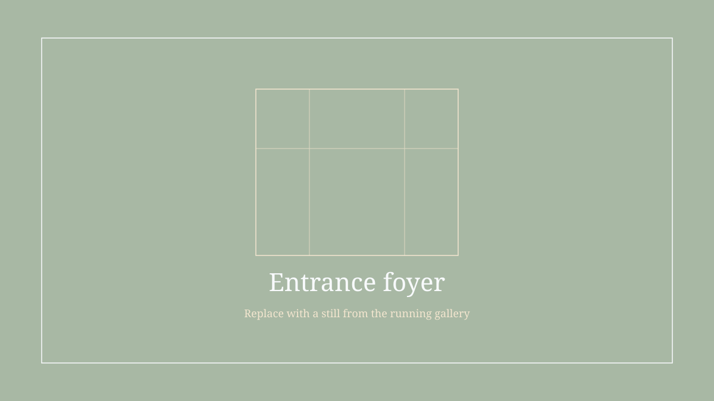
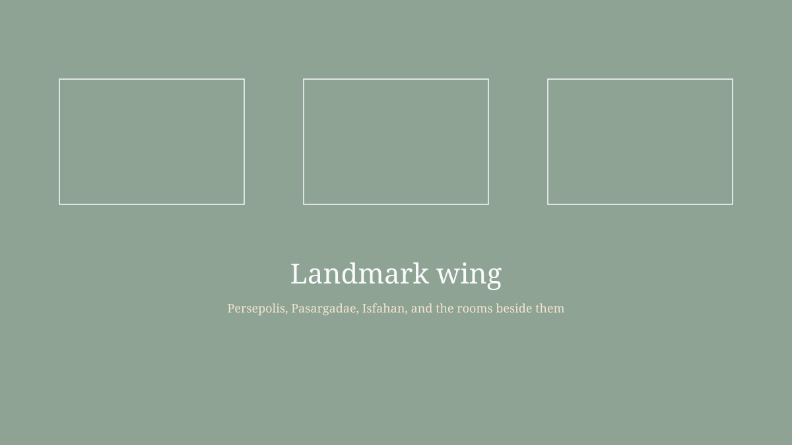
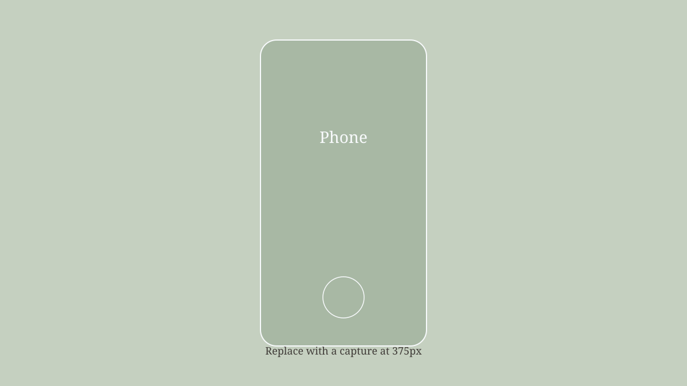

# Iranova

An immersive 3D gallery of Iranian art and culture. Visitors walk from a daylit foyer through a poem-lined passage into rooms of portraits and historic landmarks, in English, German, or Persian.

The hall is a real-time WebGL scene: olive plaster, thin white frames, one wash of daylight, and photographs you can open and read.

## Walk the rooms

| Room | What hangs there |
| --- | --- |
| Foyer and main gallery | Portraits of eight Iranian figures in science, cinema, music, poetry, medicine, and painting |
| West wing | Large photographs of historic places, in the same thin frame |
| Passage between the foyer and the main gallery | A Mowlana rubai in Nastaʿliq, split across the two walls of the arch |

**Figures.** Maryam Mirzakhani, Abbas Kiarostami, Mohammad-Reza Shajarian, Anousheh Ansari, Majid Samii, Behjat Sadr, Asghar Farhadi, and Fereydoon Moshiri.

**Landmarks.** Persepolis, the Tomb of Cyrus at Pasargadae, Naqsh-e Jahan Square, the Nasir al-Mulk Mosque, Azadi Tower, Monar Jonban, and the Sheikh Bahai Bathhouse.

The passage carries the rubai beginning *دنیا همه هیچ*. The first couplet is on the right wall as you enter, the second on the left, in a soft charcoal Nastaʿliq with no caption and no catalog number.

## Features

- **First-person walking.** On a desktop, click to walk, look with the mouse, and move with WASD or the arrow keys. On a phone or a narrow window, drag to look and use the on-screen pad to walk. A tap on a frame still opens it.
- **Detail cards.** Figures and landmarks share one frosted-glass panel. Titles, biographies, and photographer credits follow the active language, including Persian right-to-left.
- **Three languages.** English, German, and Persian, switched from the corner of the screen without leaving the hall.
- **Ambient sound.** A music toggle in the same corner, with a fade in.
- **A heading mark on touch screens.** N points toward the far end of the hall.
- **A lighter phone render.** Narrow screens draw at pixel ratio 1, without the daylight shadow map or the floor mirror, so the walk stays smooth.

## Views

These plates mark where stills belong. Replace each file in `docs/screenshots/` with a capture or a short GIF from the running gallery, and keep the same name.

<p>
  
</p>

<p>
  
</p>

<p>
  
</p>

<p>
  
</p>

Suggested captures:

1. The foyer, looking through the passage.
2. The west wing, with Persepolis and the Tomb of Cyrus in frame.
3. One passage wall, close enough to read the Nastaʿliq.
4. A phone-width view with the walk pad and the language switcher.

## Tech stack

| | |
| --- | --- |
| App | [Next.js](https://nextjs.org/) 16, React 19, TypeScript |
| 3D | [Three.js](https://threejs.org/), [React Three Fiber](https://r3f.docs.pmnd.rs/), [@react-three/drei](https://github.com/pmndrs/drei) |
| Interface | Custom CSS. Frosted panels, the language switcher, and the walk pad live in `app/globals.css` |
| Type | Cormorant Garamond and Outfit for Latin, Vazirmatn for Persian, and a self-hosted Noto Nastaʿliq Urdu for the wall poem |

## Getting started

```bash
git clone https://github.com/Salimeh1364/iranova.git
cd iranova
npm install
npm run dev
```

Open [http://localhost:3000](http://localhost:3000).

The dev script starts Next.js with webpack, which is what the font loader in this project expects.

| Script | What it does |
| --- | --- |
| `npm run dev` | Local gallery at port 3000 |
| `npm run build` | Production build |
| `npm run start` | Serve the production build |
| `npm run lint` | ESLint |

## Project map

```text
app/                 pages, global styles, ambient-audio route
components/          language switcher, detail card, walk pad, compass
content/             figure and landmark copy in English, German, and Persian
i18n/                dictionaries and the locale provider
public/images/       portrait and landmark photographs
public/audio/        ambient track
public/fonts/        Nastaʿliq face for the passage
scene/               the hall, frames, lighting, and the walker
```

## Photographs

Portrait and landmark files are freely licensed Wikimedia Commons photographs. Each open card names the photographer and the license. The wall poem is drawn in the browser. It is not a product image.

## License

Application code in this repository is the portfolio work of its author. The photographs and the Nastaʿliq font keep the licenses named beside them: Commons credits in the detail cards, and the SIL Open Font License for Noto Nastaʿliq Urdu.
